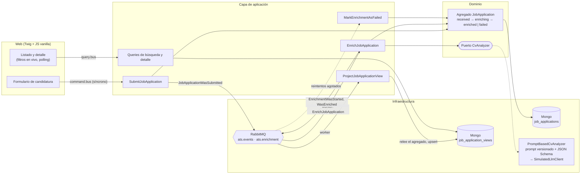

# ATS PoC: postular, enriquecer con IA, consultar

[🇬🇧 English](README.md) · 🇪🇸 Español

Un Applicant Tracking System mínimo, hecho para la [prueba técnica de Viterbit](https://github.com/viterbit/tech-exercise).
Los candidatos se postulan a un puesto pegando su CV como texto. Después, una IA simulada y
asíncrona resume el CV y lo puntúa frente al puesto, y los recruiters consultan las candidaturas
con filtros y búsqueda en vivo.

**Stack:** PHP 8.4 · Symfony 8.1 · Symfony Messenger + RabbitMQ · MongoDB · Twig + Tailwind v4 ·
JS vanilla · PHPUnit · Docker Compose.

---

## Cómo arrancarlo

Solo hacen falta Docker (con Compose) y `make`.

```bash
make init
```

Construye las imágenes, levanta todos los servicios (web, **worker de Messenger**, MongoDB y
RabbitMQ), instala dependencias, crea los índices, carga **4 puestos de ejemplo** y compila el CSS.

| | |
|---|---|
| Aplicación | http://localhost:8080 |
| UI de RabbitMQ | http://localhost:15673 (guest / guest) |
| MongoDB | `localhost:27018` |

Después:

```bash
make demo      # envía 7 candidaturas de ejemplo y se ve en directo cómo se enriquecen
make test      # tests unitarios, de integración y funcionales (contra MongoDB real)
make qa        # php-cs-fixer, phpcs (PSR-12), PHPStan
make logs      # sigue los logs del worker
make help      # todos los comandos
```

### Recorrido de dos minutos

1. **Postularse:** abre un puesto, rellena el formulario y pega un CV. Llegas a tu candidatura,
   que muestra *Received*, después *Analysing CV* y por último *Enriched*, con un resumen y un
   score. La página se actualiza sola.
2. **Consultar:** entra en *Applications*. El listado sale de más reciente a más antigua, los
   filtros (estado, puesto) y la búsqueda (nombre o email) se aplican mientras escribes, y la URL
   se puede compartir.
3. **Ver un fallo:** pon `[simulate-llm-failure]` en cualquier parte de un CV. El LLM simulado
   responde con una salida inválida, el worker lo intenta 3 veces y la candidatura termina en
   *Failed*, con el motivo a la vista.

## Arquitectura

DDD con organización hexagonal y CQRS sobre Symfony Messenger, en un único bounded context
(`Recruitment`) más un `SharedKernel`.



- **Escritura:** los comandos modifican el agregado `JobApplication`, que registra eventos de
  dominio. El agregado se guarda en `job_applications` y sus eventos se publican en RabbitMQ.
- **Parte asíncrona:** el worker consume los eventos. Un envío se convierte en un comando
  `EnrichJobApplication`, que va a su propia cola y tiene sus propios reintentos. Cada evento
  refresca el modelo de lectura.
- **Lectura:** el listado y el detalle consultan `job_application_views`, una colección plana
  indexada para el listado.
- **IA:** el dominio solo conoce el puerto `CvAnalyzer`. El adaptador rellena un prompt
  versionado, llama a un `LlmClient` y valida la respuesta contra un JSON Schema. El cliente es
  una simulación determinista, porque el ejercicio prohíbe llamar a APIs reales.

```
src/
├── SharedKernel/            raíz de agregado, eventos de dominio, ids UUID v7, pegamento Mongo/Messenger/HTTP
└── Recruitment/
    ├── Domain/Write/        agregados, value objects, eventos, excepciones, puertos
    ├── Domain/Read/         modelo de lectura y su puerto
    ├── Application/         comandos, queries, suscriptores de eventos, proyector
    └── Infrastructure/      repositorios Mongo, listener de Messenger, adaptador de IA, HTTP, consola
```

## Decisiones clave

Todas las decisiones, con las alternativas descartadas, están en **[docs/DECISIONS.es.md](docs/DECISIONS.es.md)**.
Las que más dan para hablar:

| Decisión | Por qué, en una línea | ADR |
|---|---|---|
| Un único bounded context; el agregado se llama `JobApplication` | Un solo lenguaje y un solo motivo de cambio; «Application» ya es el nombre de una capa | 005 |
| Dominio puro, con la máquina de estados en un enum | Las reglas se leen y se prueban sin arrancar nada | 006 |
| Solo MongoDB, con colecciones de escritura y de lectura separadas | CQRS separa modelos, no motores; un motor menos en un PoC | 009 |
| Driver oficial en lugar de Doctrine ODM | Mapeo explícito y sin atributos de persistencia en el dominio | 010 |
| Evento → comando para el enriquecimiento | El hecho puede tener muchos suscriptores; la intención tiene su propia cola y sus reintentos | 008 |
| Proyección que relee el agregado | Idempotente, independiente del orden y reconstruible (`app:views:rebuild`) | 007 |
| El fallo definitivo lo decide el worker (`WorkerMessageFailedEvent`) | Solo el worker sabe cuándo se han agotado los reintentos | 012 |
| El LLM se trata como entrada no confiable (prompt versionado, JSON Schema, reintentos) | Cambiar a un modelo real es una clase; nada más cambia | 013 |
| Los tests ejecutan un worker real de Messenger sobre transports en memoria | Comprueban el estado entre pasos asíncronos, que es donde están los bugs | 014 |
| Fragmentos HTML y polling en lugar de una SPA | Un solo renderizador, sin cadena de build, funciona sin JS | 015 |
| Higiene de seguridad: Symfony 8.1, control de CVE de PHP, sin superficie de subida | La 8.0 no tiene parches; php2shell (CVE-2026-109618/9) salió durante el ejercicio | 002, 004 |

## Tests

117 tests: unitarios (dominio, casos de uso con dobles de los puertos, adaptador de IA), de
integración (repositorios de MongoDB, el flujo asíncrono completo con un worker real, el comando
de reconstrucción) y funcionales (los flujos HTTP).

| Criterio de aceptación | Lo cubre |
|---|---|
| Al enviar se crea un registro con `appliedAt` y el estado por defecto | `SubmitJobApplicationHandlerTest`, `ApplyToAPositionTest` |
| El enriquecimiento asíncrono añade resumen y score | `EnrichmentFlowTest`, `ApplyToAPositionTest` |
| Reintentos y fallo definitivo | `EnrichmentFlowTest`, `ApplyToAPositionTest::testAFailedEnrichmentIsExplainedOnTheDetailPage` |
| El listado va de más reciente a más antigua, con filtros y búsqueda | `MongoJobApplicationViewRepositoryTest`, `BrowseApplicationsTest` |
| El detalle muestra todos los datos, enriquecimiento incluido | `ApplyToAPositionTest` |

El JavaScript no tiene tests automáticos: se ha comprobado a mano en el navegador (ver «Con más tiempo»).

## Con más tiempo

- **Outbox transaccional**, para que guardar en MongoDB y publicar en RabbitMQ no puedan quedar desincronizados (ADR-011).
- **Push en lugar de polling** (Mercure o SSE) para las actualizaciones de estado (ADR-015).
- **Reintentar un enriquecimiento fallido** desde la UI, como caso de uso explícito `failed → enriching` (ADR-012).
- **Un cliente de LLM real** detrás de `LlmClient`, con timeouts, límite de peticiones y control
  de coste, y la salida estructurada del proveedor alimentada con el mismo JSON Schema.
- **Autenticación y roles**, separando la zona de candidatos de la de recruiters.
- **Tests end-to-end en navegador** (Playwright) para los filtros en vivo y el polling.
- **Bloqueo optimista** (un campo `version`) cuando más de un escritor pueda tocar una candidatura (ADR-010).
- **Búsqueda a escala:** un índice de texto o Atlas Search en lugar de una regex sin anclar.
- **Eventos de integración en JSON y versionados** si otros servicios empiezan a consumir estos eventos.

## Cómo he usado la IA

Lo he construido con **Claude Code** como pair programmer, en fases cortas: plan, mi revisión y
mi OK, implementación y un resumen al final. Las fases fueron dominio, aplicación,
infraestructura, UI y documentación.

- **Planificación:** escribí el encargo (stack, arquitectura, proceso). El asistente leyó el
  ejercicio y propuso un plan, y yo tomé las decisiones que le dan forma: solo MongoDB en lugar
  de MySQL más MongoDB, Tailwind sobre mis propios design tokens y documentación bilingüe.
- **Implementación:** el asistente escribió el código siguiendo las convenciones de mis propios
  servicios Symfony, así que el resultado se lee como código que mantengo. Revisé cada fase antes
  de pasar a la siguiente.
- **Verificación:** no se aceptó nada por fe. Los tests corren contra MongoDB real, el flujo
  asíncrono se probó de punta a punta contra RabbitMQ real y la UI se revisó en el navegador en
  modo claro, oscuro y móvil. Así salieron y se corrigieron varios problemas:
  - MongoDB 8 no arranca con los kernels actuales de Docker Desktop;
  - Symfony 8.0 está bloqueado por avisos de seguridad;
  - en los tests, los transports en memoria aplican los retardos de reintento y se vacían entre peticiones.
- **Seguridad:** durante el ejercicio salió una release crítica de seguridad de PHP (php2shell).
  El asistente investigó los avisos, comprobó que la imagen base seguía siendo vulnerable y añadió
  la mitigación y la salvaguarda que se describen en el ADR-004.
- **Documentación:** `docs/DECISIONS.es.md` se escribió a la vez que el código, una entrada por decisión.
