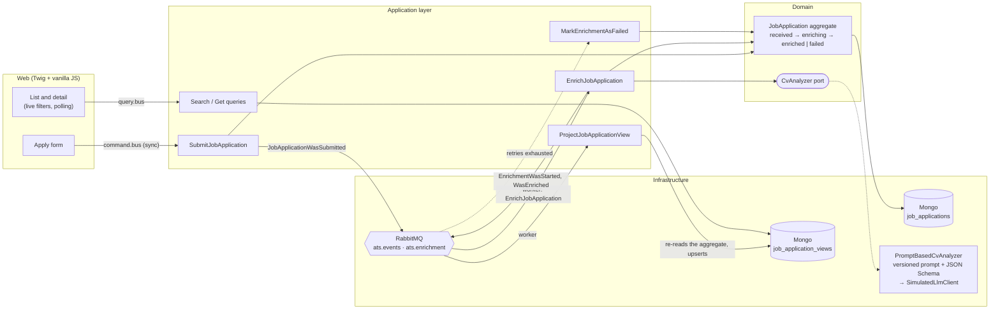

# ATS PoC: apply, enrich with AI, browse

🇬🇧 English · [🇪🇸 Español](README.es.md)

A minimal Applicant Tracking System built for the [Viterbit technical exercise](https://github.com/viterbit/tech-exercise).
Candidates apply to a position by pasting their CV as text. An asynchronous, simulated AI then
summarises the CV and scores it against the position, and recruiters browse the applications
with live filters and search.

**Stack:** PHP 8.4 · Symfony 8.1 · Symfony Messenger + RabbitMQ · MongoDB · Twig + Tailwind v4 ·
vanilla JS · PHPUnit · Docker Compose.

---

## Run it

You only need Docker (with Compose) and `make`.

```bash
make init
```

This builds the images, starts every service (web, **Messenger worker**, MongoDB, RabbitMQ),
installs dependencies, creates the indexes, loads **4 sample positions** and builds the CSS.

| | |
|---|---|
| App | http://localhost:8080 |
| RabbitMQ UI | http://localhost:15673 (guest / guest) |
| MongoDB | `localhost:27018` |

Then:

```bash
make demo      # submit 7 sample applications and watch them get enriched live
make test      # unit, integration and functional tests (real MongoDB)
make qa        # php-cs-fixer, phpcs (PSR-12), PHPStan
make logs      # follow the worker
make help      # every target
```

### A two-minute tour

1. **Apply:** open a position, fill the form and paste a CV. You land on your application,
   which shows *Received*, then *Analysing CV*, then *Enriched* with a summary and a score.
   The page updates by itself.
2. **Browse:** go to *Applications*. The list is newest first, filters (status, position) and
   search (name or email) apply as you type, and the URL can be shared.
3. **See a failure:** put `[simulate-llm-failure]` anywhere in a CV. The fake LLM answers with
   invalid output, the worker retries it 3 times, and the application ends up *Failed* with
   the reason shown.

## Architecture

DDD with a hexagonal layout and CQRS on Symfony Messenger, in one bounded context
(`Recruitment`) plus a `SharedKernel`.



- **Write side:** commands change the `JobApplication` aggregate, which records domain events.
  The aggregate is saved to `job_applications` and its events are published to RabbitMQ.
- **Async side:** the worker consumes the events. A submission turns into an
  `EnrichJobApplication` command on its own queue, which has its own retries. Every event
  refreshes the read model.
- **Read side:** the list and detail pages query `job_application_views`, a flat collection
  indexed for the list.
- **AI:** the domain only knows the `CvAnalyzer` port. The adapter renders a versioned prompt,
  calls an `LlmClient` and validates the answer against a JSON Schema. The client is a
  deterministic simulation, because the exercise forbids real API calls.

```
src/
├── SharedKernel/            aggregate root, domain events, UUID v7 ids, Mongo/Messenger/HTTP glue
└── Recruitment/
    ├── Domain/Write/        aggregates, value objects, events, exceptions, ports
    ├── Domain/Read/         read model and its port
    ├── Application/         commands, queries, event subscribers, projector
    └── Infrastructure/      Mongo repositories, Messenger listener, AI adapter, HTTP, console
```

## Key decisions

Every decision, with the alternatives that were discarded, is in **[docs/DECISIONS.md](docs/DECISIONS.md)**.
The ones most worth discussing:

| Decision | Why, in one line | ADR |
|---|---|---|
| One bounded context; the aggregate is `JobApplication` | One language and one reason to change; "Application" already names a layer | 005 |
| A pure domain with the state machine in one enum | The rules can be read and tested without booting anything | 006 |
| MongoDB only, with separate write and read collections | CQRS separates models, not engines; one engine fewer for a PoC | 009 |
| The official driver instead of Doctrine ODM | Explicit mapping and no persistence attributes in the domain | 010 |
| Event → command for the enrichment | The fact can have many subscribers; the intent has its own queue and retries | 008 |
| A projection that re-reads the aggregate | Idempotent, order-independent and rebuildable (`app:views:rebuild`) | 007 |
| The final failure comes from the worker (`WorkerMessageFailedEvent`) | Only the worker knows that retries are exhausted | 012 |
| An LLM treated as untrusted (versioned prompt, JSON Schema, retries) | Swapping in a real model is one class; nothing else changes | 013 |
| Tests run a real Messenger worker over in-memory transports | They assert the state between asynchronous steps, where the bugs are | 014 |
| HTML fragments and polling instead of a SPA | One renderer, no build chain, works without JS | 015 |
| Security housekeeping: Symfony 8.1, PHP CVE guard, no upload surface | 8.0 is unpatched; php2shell (CVE-2026-109618/9) was published during the exercise | 002, 004 |

## Tests

117 tests: unit tests (domain, use cases with doubles of the ports, AI adapter), integration
tests (MongoDB repositories, the full asynchronous flow with a real worker, the rebuild
command) and functional tests (the HTTP flows).

| Acceptance criterion | Covered by |
|---|---|
| Submitting creates a record with `appliedAt` and the default status | `SubmitJobApplicationHandlerTest`, `ApplyToAPositionTest` |
| Asynchronous enrichment adds a summary and a score | `EnrichmentFlowTest`, `ApplyToAPositionTest` |
| Retries and the final failure | `EnrichmentFlowTest`, `ApplyToAPositionTest::testAFailedEnrichmentIsExplainedOnTheDetailPage` |
| The list is newest first, with filters and search | `MongoJobApplicationViewRepositoryTest`, `BrowseApplicationsTest` |
| The detail view shows all the data, including the enrichment | `ApplyToAPositionTest` |

The JavaScript has no automated tests: it is checked by hand in the browser (see "With more time").

## With more time

- **Transactional outbox**, so that saving to MongoDB and publishing to RabbitMQ cannot diverge (ADR-011).
- **Push instead of polling** (Mercure or SSE) for status updates (ADR-015).
- **Retrying a failed enrichment** from the UI, as an explicit `failed → enriching` use case (ADR-012).
- **A real LLM client** behind `LlmClient`, with timeouts, rate limiting and cost tracking, and
  the provider's structured output fed with the same JSON Schema.
- **Authentication and roles**, separating the candidate and recruiter areas.
- **Browser end-to-end tests** (Playwright) for the live filters and polling.
- **Optimistic locking** (a `version` field) once more than one writer can touch an application (ADR-010).
- **Search at scale:** a text index or Atlas Search instead of an unanchored regex.
- **JSON, versioned integration events** if other services start consuming these events.

## How I used AI

I built this with **Claude Code** as a pair programmer, working in short phases: plan, my
review and OK, implementation, then a summary. The phases were domain, application,
infrastructure, UI and docs.

- **Planning:** I wrote the brief (stack, architecture, process). The assistant read the
  exercise and proposed a plan, and I made the calls that shape it: MongoDB only instead of
  MySQL plus MongoDB, Tailwind on top of my own design tokens, and bilingual docs.
- **Implementation:** the assistant wrote the code following the conventions of my own
  Symfony services, so the result reads like code I maintain. I reviewed each phase before
  moving on.
- **Verification:** nothing was accepted on trust. The test suite runs against real MongoDB,
  the asynchronous flow was exercised end to end against real RabbitMQ, and the UI was checked
  in a browser in light, dark and mobile layouts. Several issues were found and fixed this way:
  - MongoDB 8 does not start on current Docker Desktop kernels;
  - Symfony 8.0 is blocked by security advisories;
  - in-memory transports apply retry delays and are reset between requests in tests.
- **Security:** a critical PHP security release (php2shell) came out during the exercise. The
  assistant researched the advisories, found that the base image was still vulnerable, and
  added the mitigation and the guard described in ADR-004.
- **Docs:** `docs/DECISIONS.md` was written alongside the code, one entry per decision.
